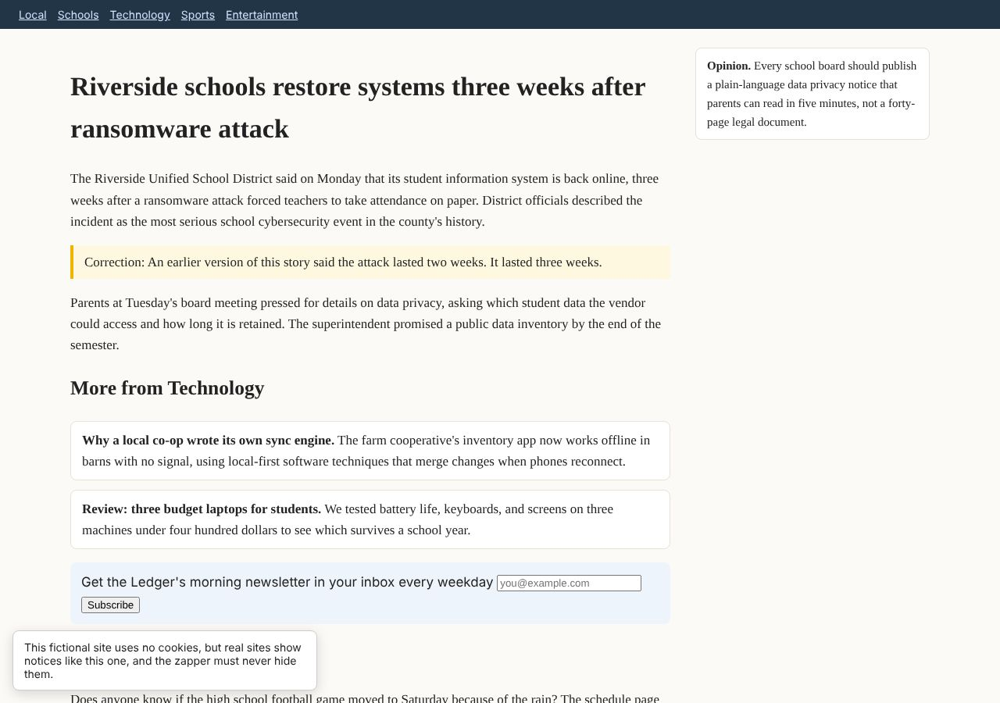
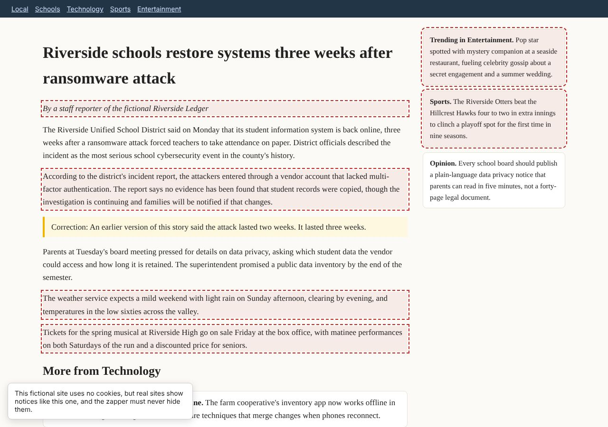
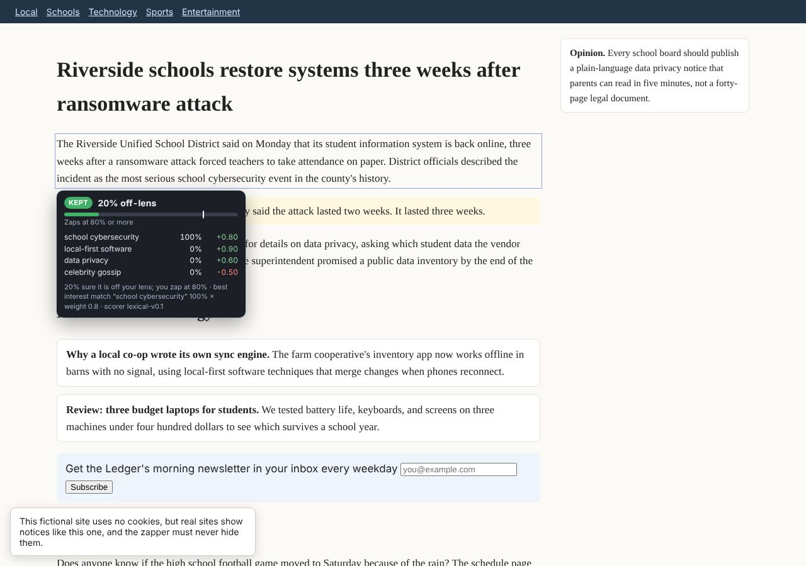
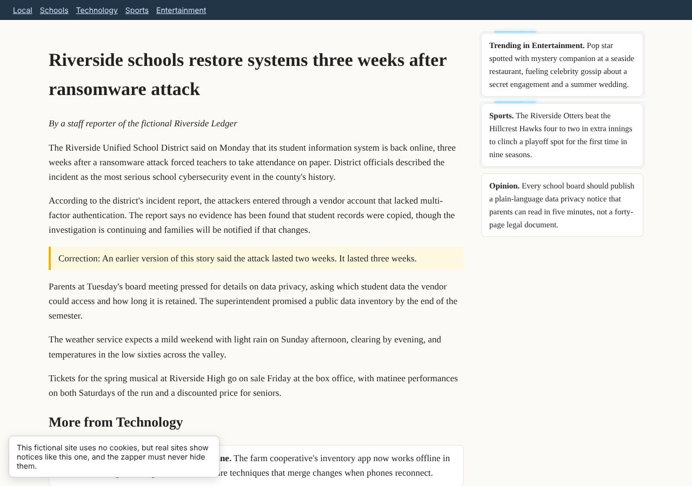
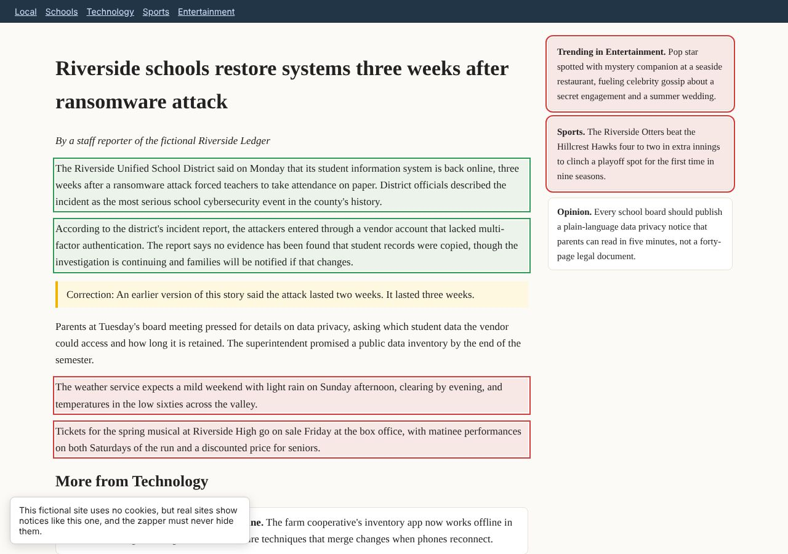
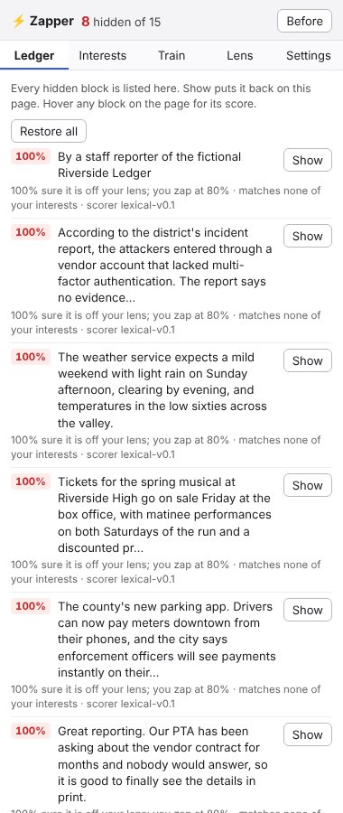
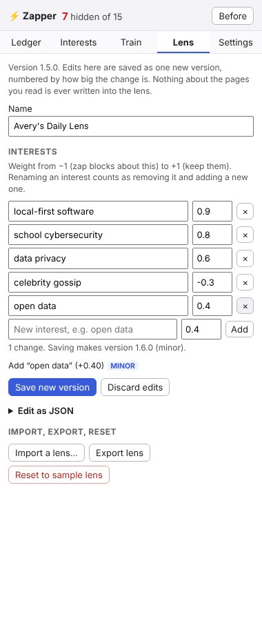
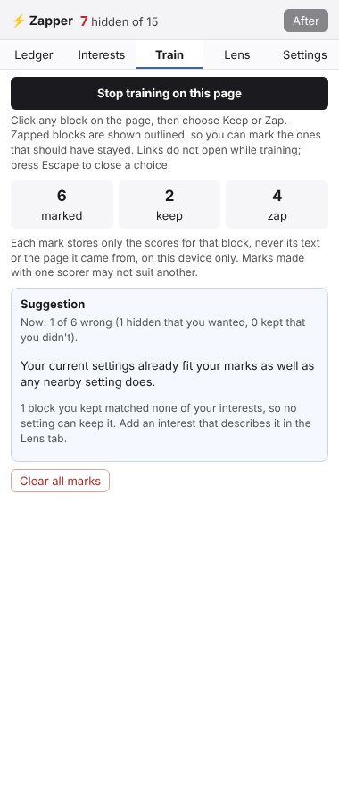

# LensPub Zapper (proof of concept)

> **Not a LensPub engine.** This tool uses your LensPub lens, but unlike a LensPub engine it hides parts of pages. A conforming Lens Engine never hides content by default ([Protocol §7.3](../spec/lenspub-protocol.md#73-unconditional-requirements)). This tool sits outside the protocol by design, and it is not tested by the [conformance suite](../conformance/README.md). The reasoning is in [Exploration: a semantic zapper built on LensPub](../docs/explorations/semantic-zapper.md), Section 5.

The zapper is a Chromium extension. On every page it splits the content into blocks, judges how well each block matches the interest topics in your [Lens Manifest](../spec/lens-manifest.md), and hides the blocks it is confident are off your lens, much like uBlock Origin's element zapper but chosen for you. Every hidden block is listed with its reasoning and can be put back.



## What it does

- **Zaps off-lens blocks.** Each block gets an "off-lens" confidence. A block is hidden when that confidence reaches your threshold. Interests you weight positively keep blocks; interests you weight negatively zap them.
- **Side panel.** The controls live in Chrome's side panel: click the toolbar button to open it. Chrome docks it beside the page and the page reflows to fit, like any browser sidebar. It follows whichever tab you're on, with five tabs: **Ledger**, **Interests**, **Train**, **Lens**, and **Settings**. With the panel closed, the toolbar badge still shows how many blocks are hidden on the page.
- **Ledger.** The panel lists every hidden block, with its off-lens score, with the reason it was hidden and a **Show** button. After every pass the zapper checks that the blocks hidden on the page are exactly the ones in the ledger. If they ever differ, it restores everything and says so.
- **Before / After.** **Before** shows the page as published, with zapped blocks outlined in red.
- **Score on hover.** Hover over any judged block to see whether it was kept or zapped, its off-lens score against your threshold, how well it matched each interest, and the reason in words. Hidden blocks can't be hovered; use **Before** to see and hover them, or read their reasons in the ledger. Turn this off under **Settings**.
- **Confidence slider.** "Zap when at least this sure." By default it applies everywhere, or you can set it for one site only.
- **Interest sliders.** One slider per topic in your lens. Changes apply on every page as soon as you move a slider and are kept on this device while you browse. **Save to lens** writes them into your lens as one new version.
- **Live sliders.** Both kinds of slider re-decide every block on each step, so blocks vanish and come back while you drag. Scores are cached, so nothing is sent to the model again.
- **Scoring as you watch.** With a model, blocks are scored a few at a time, the ones on screen first, and each is zapped as soon as its answer arrives. While a block is being scored, a small spark races round its edge, like a loading indicator; a zapped block flashes and collapses. The spark is drawn on the zapper's own layer, not on the page. Set how many requests run at once, and turn the animations off, under **Settings**. They are also off when your system asks for reduced motion.
- **Edit your lens directly.** The **Lens** tab lists your interests: rename them, change their weights, remove them, or add new ones, and see each change's impact class before you save. **Edit as JSON** opens the whole lens. Either way, saving writes one new version, numbered by the [Adaptation Model's](../spec/adaptation-model.md#4-impact-classification) rules: a small weight change or a small new interest is minor, while a removal, a rename, or any other field is major. Import, export, and reset are here too.
- **Train it.** In the **Train** tab, start training, then click blocks on the page and mark each **Keep** or **Zap**. Zapped blocks are shown during training so you can mark the wrong ones, and links don't open. After six marks, the panel suggests a threshold and interest weights that would have decided your marks your way, and shows how many it gets wrong now and after. **Try these** moves your sliders; **Save to lens** in **Interests** keeps them. A block you kept that matches none of your interests can't be fixed by any setting, so the panel tells you to add an interest for it. Each mark stores only that block's scores and your label, never its text or the page it came from.
- **Site rules.** Some sites lay items out in ways the generic splitter can't find, such as Hacker News, where each story is a set of table rows. A rule in `core/segment.js` makes each story or comment one block there.
- **Pause on this site**, and **Restore all** on any page.









| Ledger | Lens | Train |
|---|---|---|
|  |  |  |

## Never zapped

The zapper never hides the following:
- headings, navigation, forms, dialogs (including cookie notices), and editable areas;
- corrections, clarifications, retractions, and passages citing a primary source;
- any block the scorer returned nothing for: when the model says nothing, the block stays.

Zapping is a style change only. Nodes are never removed or rewritten, so **Before** and **Show** always give back the page exactly as published.

## Scorers

| Scorer | Setup | Behavior |
|---|---|---|
| **Words only** (default) | None | Matches your topic words. It's fast and deterministic, but it zaps far too much on real pages, because a block about your topic that never uses its words looks off-lens. The demo page includes one such paragraph on purpose. |
| **Local decision model** (recommended) | llama.cpp's `llama-server` on this machine | A decision model such as Clef-flash answers one yes/no question per topic for every block, plus one question asking whether the block is a correction or cites a source. It returns calibrated probabilities from a single forward pass, with no text to parse. Moving a slider re-runs only the decision step, never the model. |
| **Local chat model** | Ollama, LM Studio, or any OpenAI-compatible server | Any instruction-following model, asked to return scores as JSON. It's slower and less calibrated than a decision model, but works with what you may already have installed. |

**Only addresses on this machine are accepted** (localhost, 127.0.0.1, ::1), so page text never leaves your device ([ADR-0005](../adr/0005-local-only-default.md)). A block counts as a correction or source if either the model or the word-level check says so.

### Running a decision model locally

Decision models run in llama.cpp's `llama-server`, which serves them at `/v1/systemone`. **Ollama and LM Studio can't serve them**: a chat runner loads only the backbone and produces noise.

1. **Install a recent llama.cpp.** Use `brew install llama.cpp` (or `brew upgrade llama.cpp`) on macOS, `winget install llama.cpp` on Windows, or a release build on Linux. Decision-model support (`/v1/systemone`) arrived in October 2026. Check your build with `llama-server --version`.
2. **Start a model in its own terminal.** `llama-server` keeps running in the foreground, so run the benchmark from a second terminal. Each command downloads its model on first run. If port 8080 is taken, use any other port and pass the same one to the zapper.

   ```
   llama-server -hf ggml-org/Kev-4B-GGUF --port 8080 --parallel 4
   ```

   If long passages fail with a "too large to process" error, add `-ub 2048`.

   **Clef-flash isn't in released llama.cpp yet.** As of 2026-11-01 its support is an unmerged draft ([llama.cpp PR #29831](https://github.com/ggml-org/llama.cpp/pull/29831)), so release builds fail with `unknown model architecture: 'clef'`. To try it now, build that PR yourself. The PR handles one sequence per batch, so use `--parallel 1` and `--concurrency 1`:

   ```
   git clone https://github.com/ggml-org/llama.cpp && cd llama.cpp
   git fetch origin pull/29831/head:clef && git checkout clef
   cmake -B build && cmake --build build --config Release -j
   ./build/bin/llama-server -hf ggml-org/Clef-Flash-GGUF:Q4_K_M --port 8080 --parallel 1
   ```

3. **Point the zapper at it.** In the side panel's **Settings** tab, choose **A model running on this machine**, then the **Decision model via llama-server** API, with endpoint `http://127.0.0.1:8080`. Leave Model empty, set **Requests at once** to llama-server's `--parallel` value, and press **Test connection**.
4. **Measure it on your machine.** This scores 28 hand-labelled passages and reports latency and wrong-zap rates at each threshold, next to the word-only baseline:

   ```
   npm run zapper:bench                                  # default: decision model at 127.0.0.1:8080
   npm run zapper:bench -- --endpoint http://127.0.0.1:8181   # a different port
   npm run zapper:bench -- --concurrency 4               # match --parallel
   npm run zapper:bench -- --api ollama --model qwen3:4b # a chat model in Ollama, for comparison
   ```

| Model | Size | Notes |
|---|---|---|
| `ggml-org/Kev-4B-GGUF` | 4B | Works in released llama.cpp. The place to start. Apache-2.0. |
| `ggml-org/Clef-Flash-GGUF:Q4_K_M` | 9B; about a 6 GB download | Cloudflare's model and the best fit on paper, but it **needs the draft-PR build above**. It wants a GPU or Apple-silicon unified memory with roughly 8 GB free. Apache-2.0. |
| `ggml-org/Julia-1-GGUF` | 144M | Tiny and multilingual, and fine on a laptop CPU. Expect weaker judgments; the benchmark will tell you how much. Apache-2.0. |

The sizes and licenses come from the model publishers and llama.cpp's announcement. **None of these models has been run with this code yet**: the cloud environment this was built in can't download models. The extension's model path, and the benchmark, were tested only against a stand-in server with canned answers. Your first benchmark run is the first real measurement.

### Using a chat model instead

```
OLLAMA_ORIGINS=chrome-extension://* ollama serve
ollama pull qwen3:4b
```

Then choose the **Chat model via Ollama** API with endpoint `http://localhost:11434` and model `qwen3:4b`.

## Install

1. Open `chrome://extensions` and turn on **Developer mode**.
2. Choose **Load unpacked** and select this `zapper/` directory.
3. Open any http(s) page and click the zapper's toolbar button (pin it from the puzzle-piece menu) to open the side panel. The side panel needs Chrome 116 or later.

You can load the reference engine in `poc/` at the same time; the two don't interact. The zapper starts with a copy of the sample lens `avery-daily`. Import your own lens from the **Lens** tab.

## What it stores, and where

Everything is kept in `chrome.storage.local` on this device and never synced.

| Item | What it is | Leaves the device? |
|---|---|---|
| Your lens | A Lens Manifest, history-free | Only when you press **Export** |
| Unsaved slider positions | Adaptation State | Never |
| Per-site pause and threshold | Adaptation State, keyed by hostname | Never, and never written into the lens |
| Training marks | Adaptation State: one block's scores and your Keep/Zap label, no text, no address; the last 500 | Never |
| Model scores | A cache of page text and scores, in memory only | Never; gone when the browser stops the background worker |

When you press **Save to lens**, the zapper acts as a LensPub **Manifest Producer**, and that part does claim conformance:
- The new version validates against [the schema](../schemas/lens-manifest.schema.json).
- The version number is bumped by impact class: a weight change of at most 0.2 is a minor change, anything larger is major ([Adaptation Model §4](../spec/adaptation-model.md#4-impact-classification)).
- The old version is recorded in `versionHistory` by its content hash, with no date.
- `modified` is rounded to the day.
- A signature and publisher are removed, because they no longer describe the edited document.
- Nothing about the pages you read is ever written into the lens.

## Lens features it reads but does not use

The zapper reads these from your lens but doesn't act on them, and it lists them under **Settings** instead of dropping them silently:
- Domain Scope restrictions on priorities: the zapper applies every priority on every page.
- Source trust and distrust.
- Presentation preferences.
- Subscriptions.
- Extensions.

## Known limits

- **Splitting the page into blocks is heuristic.** Paragraphs, list items, table cells, cards, and sidebars become blocks; text under 40 characters is never judged, except an item a site rule names. Odd layouts will split oddly; a site rule is the fix for a site you use a lot.
- **Training learns weights, not topics.** It can raise, lower, or flip an interest you already have, and move the threshold. It can't invent a new interest; it tells you when one is needed.
- **Content shifts after the page loads.** Blocks are hidden after the page renders, so the layout moves once, and a model scorer adds its own delay.
- **Prompt injection.** Page text goes to the model as data, with an instruction to ignore instructions inside it. That reduces the risk of a page steering the model, but doesn't remove it.
- **Pages can tell the extension is installed.** The extension exposes its own module files to pages, so a page can detect it. The controls are in the side panel, which pages can't reach, and the on-page popover is in a closed shadow root.
- **The tool only lists what it hides.** It does not label the blocks it keeps as being on your lens.

## Tests

```
npm run zapper:test                           # pure modules, plus Ajv validation of edited lenses (runs in CI)
node zapper/test/browser-check.mjs [--screenshots]   # the extension in Chromium, against demo/fixture.html
```

The browser check loads the unpacked extension against the fictional fixture page and checks:
- the expected blocks are hidden;
- controls and the correction never are;
- the side panel (opened as a tab pinned to the page, since headless Chromium can't show a side panel) shows the hidden count, and the page's own layout is untouched;
- **Before** and **Show** work, and every hidden block is listed;
- hovering a block shows its score and reason;
- moving the confidence slider changes what is hidden straight away;
- saving a slider change writes a valid new lens version;
- the lens editor saves an added interest as a minor version and a removal as a major one, and refuses invalid JSON;
- training: clicks mark blocks instead of following links, marks hold only scores and a label, and the panel gives a suggestion;
- on a fictional page laid out in table rows (`demo/link-table.html`, served at the Hacker News hostname), each story is one block, and the top links are never judged;
- the model-scorer path works over all three APIs (against a stand-in model server), including that a block the model skips stays visible, never sends more requests at once than the setting allows, and draws the scoring spark while the model works.

The check needs Playwright with Chromium and isn't run in CI.

## Layout

```
zapper/
  manifest.json          MV3 manifest
  core/                  pure, DOM-free modules (scoring, decisions, ledger check, lens editing,
                         page splitting rules, training suggestions)
  background/            storage, lens saving, local-model requests
  content/               page segmentation, zapping, the hover popover, the scoring spark, training clicks
  sidepanel/             Chrome side panel: ledger, interests, training, lens editor, settings
  lenses/sample-lens.json
  demo/fixture.html      a fictional page for trying it
  demo/link-table.html   a fictional table-row link page, for the site-rule check
  bench/                 benchmark: speed and wrong-zap rates for a scorer on your machine
  test/                  Node tests and the browser check
```

Licensed Apache-2.0, like all code in this repository.
